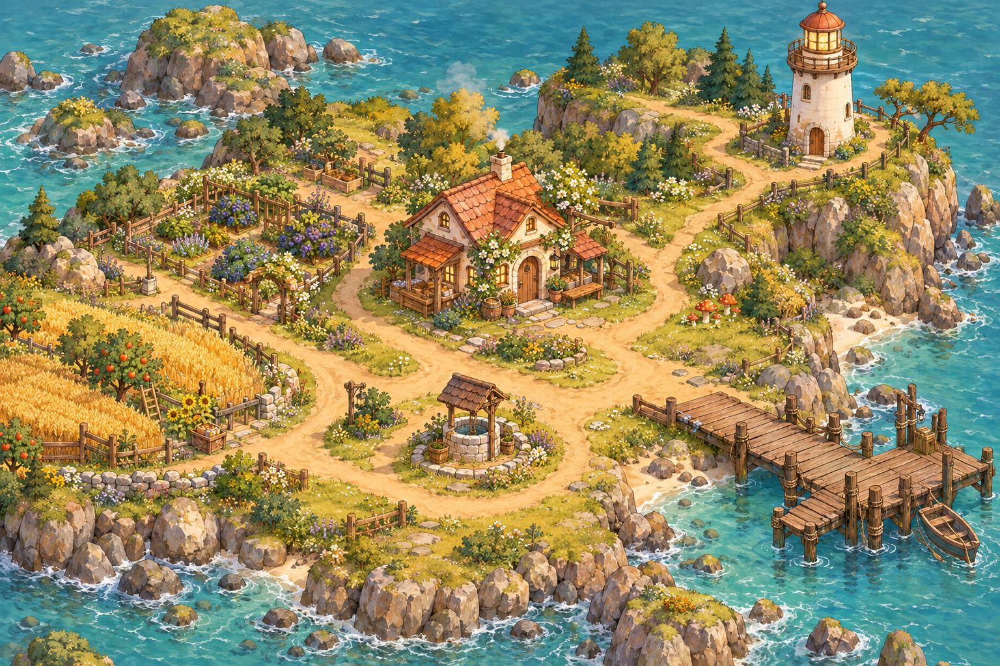
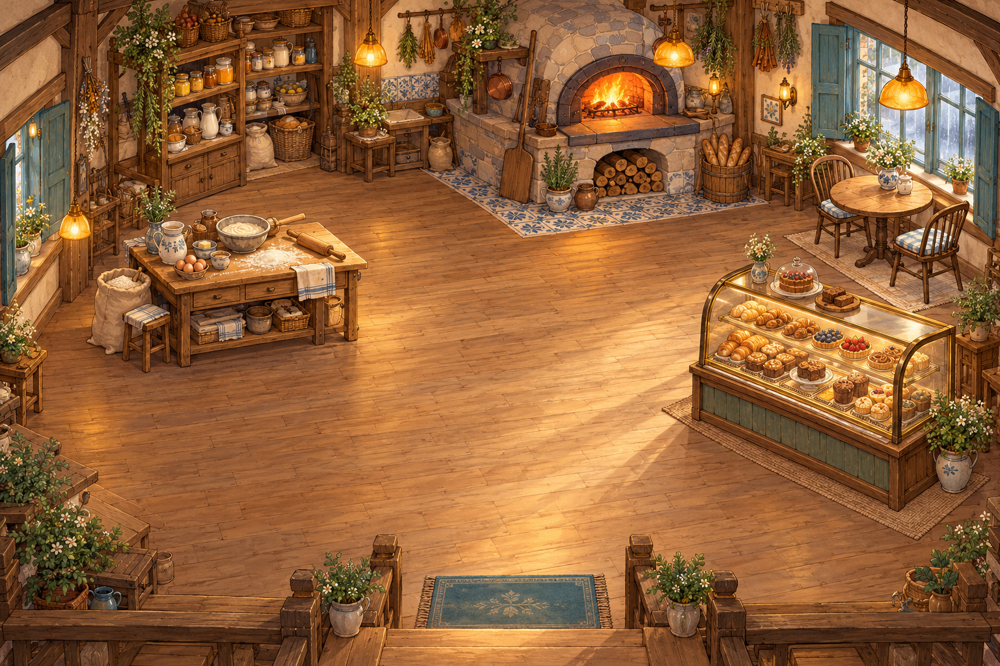

# Rainy Day Bakery · Revised edition

Game bakery pesisir untuk **Unity 2022.3.62f1**, direvisi berdasarkan [GDD v2](Docs/GDD-Revised-v2.pdf). Menggantikan prototipe kotak/IMGUI lama dengan lingkungan ilustrasi isometrik, sprite karakter, UI kayu-kertas, dan **URP 2D**.

## Buka di komputer kamu

1. Download **Code → Download ZIP** dari repository ini, atau `git pull` jika sudah memakai Git. Ekstrak proyek ke folder baru, misalnya `D:\RainyDayBakery-v2`. Jangan menimpa dengan mencampur folder versi lama.
2. Di **Unity Hub → Add project from disk**, pilih folder yang berisi `Assets`, `Packages`, dan `ProjectSettings`.
3. Buka dengan **2022.3.62f1** dan tunggu Package Manager mengunduh **Universal RP 14.0.11** serta uGUI. Import pertama memerlukan internet.
4. Konfigurasi pipeline 2D, sorting layers, resolusi, dan build scene dibuat otomatis oleh script editor. Jika belum terbentuk, pilih **Rainy Day Bakery → Configure URP and Project** setelah kompilasi selesai.
5. Buka **Assets/Scenes/Bakery.unity**, lalu tekan **Play**. Scene bootstrap membangun dunia dan UI saat runtime; tampilan lengkap muncul ketika Play berjalan.
6. Pilih **Buka pintu bakery**. Resolusi rekomendasi Game view **1600 × 1000**; UI juga menyesuaikan resolusi lain.

Ini proyek sumber, bukan build `.exe` yang sudah diuji. Unity Editor tidak tersedia di lingkungan pengembangan cloud ini; lihat [status validasi](Docs/VALIDATION.md).

## Loop pertama

- Klik **Bakery**, lalu **Pantry**. Kamu mendapat tepung, telur, mentega, susu, dan kayu manis. Bahan dasar selalu bisa diambil lagi.
- Buka **Buku resep**, pilih **Cinnamon Roll** saat hujan.
- Klik **Meja adonan** untuk mencampur, lalu klik tiga kali lagi untuk menguleni.
- Tunggu fermentasi **12 detik saat hujan**, atau **6 detik** pada cuaca lain. Kamu boleh berjalan selama menunggu.
- Klik **Oven batu** untuk memanggang. Angkat dengan mengklik oven lagi pada jendela keemasan yang ditampilkan. Setiap resep memiliki waktu sendiri; kabut menambah satu detik pada target.
- Klik **Etalase** untuk melayani warga. Roti lembut/terlalu matang atau resep alternatif tetap diterima. Tidak ada game over.

**Klik penanda lokasi** untuk berjalan otomatis dan berinteraksi. Alternatif: **WASD / panah + E** di dekat lokasi. Pergerakan dibatasi jaringan jalan. **Esc** menjeda; buku resep dan jurnal juga menghentikan oven. Keluar ke menu menyimpan progres.

## Cuaca, bahan, dan cerita

| Cuaca | Bahan/akses | Lokasi Aruna | Favorit |
|---|---|---|---|
| Hujan | Herba tumbuh lebih banyak, blueberry tersedia | Bakery | Cinnamon Roll |
| Kabut | Jamur liar tersedia di pesisir | Mercusuar | Roti Rempah Pesisir |
| Cerah | Ladang buah dan dermaga terbuka; buah musim dan madu | Dermaga | Baguette |

Cuaca bebas diganti. Bahan yang sudah dicampur mempertahankan resep dan waktu fermentasinya.

Temui Aruna di mercusuar saat kabut untuk memulai cerita. Kumpulkan herba dan jamur, ambil tepung dari pantry, pilih **Roti Rempah Pesisir**, lalu panggang dan antarkan langsung kepadanya saat kabut. Setelah itu, **gudang madu dermaga** terbuka saat cerah. Pengiriman melalui etalase tidak menyelesaikan permintaan pribadi ini.

Delapan resep: Baguette, Croissant, Cinnamon Roll, Sourdough, Pretzel, Melonpan, Cream Puff, dan Roti Rempah Pesisir. GDD mencantumkan tujuh nama roti tetapi menargetkan delapan; resep kedelapan menghubungkan sistem cuaca dengan cerita Aruna. Semua resep terbuka setelah lima roti dibagikan. Jurnal mencatat 10 bahan, 8 roti, hubungan warga, dan progres cerita.

Istirahat di sumur memulai hari berikutnya tanpa menghapus stok atau progres. Selesaikan batch aktif terlebih dahulu. Tidak ada batas waktu harian.

## Simpan dan bangun

Save JSON tersimpan di `Application.persistentDataPath/rainy-day-v2.json`, dengan cadangan `.bak`. Autosave setiap lima detik aktif, setelah interaksi, saat jeda, dan saat keluar. Inventori, koleksi, cerita, hari, cuaca, serta status adonan/oven ikut disimpan. Simulasi tidak berjalan saat game ditutup. Jumlah kerang dan hari dari prototipe lama dimigrasikan jika PlayerPrefs lama tersedia; lokasi penyimpanan lama dapat berbeda menurut company/product settings proyek sebelumnya.

- **Rainy Day Bakery → Verify Gameplay Rules**: jalankan tes aturan.
- **Rainy Day Bakery → Build Windows**: butuh Windows Build Support dari Unity Hub. Output berada di `Builds/Windows`; distribusikan seluruh folder hasilnya.
- Tes model tanpa Unity: `dotnet run --project Tests/ModelChecks/ModelChecks.csproj` (.NET 8).
- CI GitHub menjalankan tes model; CI ini tidak mengompilasi atau menjalankan Unity.

## Visual dan batas cakupan

Ilustrasi lingkungan dan atlas karakter/item dibuat dengan model gambar OpenAI untuk revisi ini. Sprite Mira, Nami, dan Aruna memiliki arah depan/samping/belakang; arah kiri mencerminkan samping. Animasi berjalan memakai perubahan arah dan gerak bob ringan, **belum siklus kaki per-frame**. Potret dialog memakai sprite karakter yang sama. [Kredit aset](Docs/ART-CREDITS.md).

Lingkungan adalah **ilustrasi latar utuh** dengan graf jalan/interaksi, bukan kumpulan tile lingkungan modular. Grid `Isometric Z As Y` dan Tilemap disediakan sebagai dasar pengembangan. Sistem ini memakai sorting Y untuk aktor; bangunan/furnitur pada ilustrasi belum menjadi lapisan occlusion terpisah. Detail implementasi dan perbedaan terhadap GDD ada di [pemetaan GDD](Docs/GDD-COVERAGE.md).
